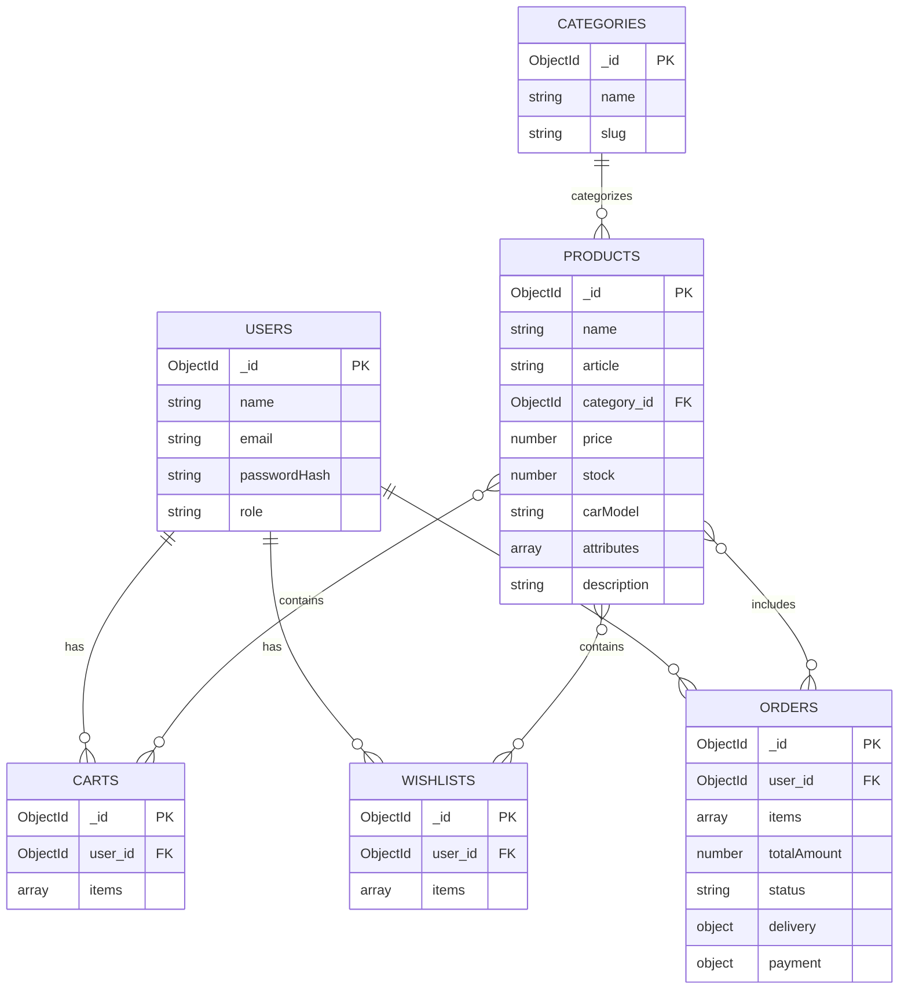

# Технічна специфікація (Specification) — Інтернет-магазин автозапчастин

Цей документ описує архітектуру, модульну структуру, схему даних у MongoDB та ключові сценарії взаємодії для вебзастосунку інтернет-магазину автомобільних запчастин. Стек: **HTML, CSS, Vanilla JS, Node.js (native), MongoDB (native driver)**.

---

## 1. Архітектура, компоненти та модулі

Застосунок побудований на клієнт-серверній архітектурі без сторонніх бекенд-фреймворків. Маршрутизація та обробка запитів виконуються за допомогою нативного модуля `http` у Node.js із розподілом по окремих файлах роутів, а робота з базою даних — через офіційний драйвер `mongodb`.

### Архітектурна схема:

```

[ Клієнт (HTML / CSS / Vanilla JS) ]
│ (HTTP / Fetch API)
▼
[ Сервер (Node.js HTTP Server + Роутери) ]
│ (MongoDB Node.js Driver)
▼
[ База даних MongoDB ]

```

### Повна модульна структура проєкту:

```text
/
├── client/                     # Клієнтська частина
│   ├── index.html              # Головна сторінка каталогу
│   ├── product.html            # Детальна картка товару
│   ├── cart.html               # Кошик покупця
│   ├── wishlist.html           # Список бажаного (обране)
│   ├── auth.html               # Сторінка авторизації та реєстрації
│   ├── checkout.html           # Оформлення замовлення (доставка/оплата)
│   ├── admin.html              # Панель адміністратора (CRUD товарів)
│   ├── css/
│   │   └── style.css           # Загальні стилі інтерфейсу
│   └── js/
│       ├── api.js              # Модуль для виконання fetch-запитів до бекенду
│       ├── auth.js             # Логіка входу, реєстрації та сесій
│       ├── catalog.js          # Відображення каталогу та фільтрів
│       ├── productDetail.js    # Логіка картки товару та динамічних характеристик
│       ├── cart.js             # Логіка керування кошиком
│       ├── wishlist.js         # Логіка списку бажаного
│       ├── checkout.js         # Обробка даних доставки та оплати
│       └── admin.js            # Інтерфейс адміністратора
│
├── server/                     # Серверна частина (Node.js native)
│   ├── server.js               # Головна точка входу (http.createServer)
│   ├── db.js                   # Підключення до MongoDB та кешування клієнта
│   ├── context.js              # Налаштування AsyncLocalStorage для business-process ID
│   ├── controllers/            # Бізнес-логіка (отримують контекст, не знають про HTTP)
│   │   ├── authController.js   # Хешування паролів та перевірка автентифікації
│   │   ├── productController.js# Обробка товарів та поліморфних атрибутів
│   │   ├── cartController.js   # Управління кошиком користувача
│   │   ├── wishlistController.js# Управління списком бажаного
│   │   └── orderController.js  # Створення замовлень та розрахунок доставки
│   ├── repositories/           # DAO (Data Access Objects) - тільки тут виконується робота з БД
│   │   ├── productRepo.js
│   │   └── orderRepo.js
│   └── routes/                 # Маршрутизація запитів (HTTP-рівень)
│       ├── authRoutes.js       # Роути для авторизації та реєстрації
│       ├── productRoutes.js    # Роути для каталогу та карток товарів
│       └── orderRoutes.js      # Роути для замовлень, кошика та обраного
│
├── package.json
└── spec.md

```

---

## 2. Структура даних та зв'язки (ER-діаграма MongoDB)



---

## 3. Ключові сценарії та оновлення даних

### Сценарій 1: Реєстрація нового користувача (`auth.html` + `authRoutes.js`)

1. **Клієнт:** Користувач заповнює форму реєстрації та надсилає POST-запит.
2. **Сервер:** `authRoutes.js` передає дані до `authController.js`. Контролер валідує дані, хешує пароль і через репозиторій створює новий запис у колекції `USERS`.
3. **Клієнт:** Отримує повідомлення про успішну реєстрацію та перенаправляється на сторінку входу.

### Сценарій 2: Авторизація (`auth.html` + `authRoutes.js`)

1. **Клієнт:** Користувач вводить облікові дані. `auth.js` надсилає POST-запит через `api.js`.
2. **Сервер:** `server.js` ініціалізує контекст запиту (`AsyncLocalStorage` з `business-process ID`) і спрямовує запит до `authRoutes.js`. `authController.js` перевіряє хеш пароля в колекції `USERS` і генерує сесію/токен.
3. **Клієнт:** Успішна відповідь зберігається в `localStorage`, після чого відкривається головна сторінка.

### Сценарій 3: Перегляд каталогу товарів із фільтрами (`index.html` + `productRoutes.js`)

1. **Клієнт:** Відкриває сторінку каталогу або застосовує фільтри (марка авто, категорія), надсилаючи GET-запит.
2. **Сервер:** `productController.js` звертається до `productRepo.js`. Для уникнення проблеми N+1 репозиторій виконує агрегацію (`$lookup`), одним запитом об'єднуючи колекції `PRODUCTS` та `CATEGORIES`.
3. **Клієнт:** Рендерить відфільтрований список товарів із коректними назвами категорій.

### Сценарій 4: Перегляд картки товару (`product.html` + `productRoutes.js`)

1. **Клієнт:** Користувач відкриває `product.html?id=...`. `productDetail.js` надсилає GET-запит на сервер.
2. **Сервер:** `productRoutes.js` передає запит до `productController.js`, який витягує документ із колекції `PRODUCTS`, включно з поліморфними параметрами з поля `attributes`.
3. **Клієнт:** Динамічно рендерить технічні характеристики залежно від типу запчастини.

### Сценарій 5: Управління кошиком (`cart.html` + `orderRoutes.js`)

1. **Клієнт:** Натискає кнопку «В кошик», ініціюючи POST/PUT-запит із вказанням ID товару та кількості.
2. **Сервер:** `cartController.js` перевіряє доступний залишок (`PRODUCTS.stock`). Якщо товару достатньо, оновлює документ користувача в колекції `CARTS` (додає товар або збільшує кількість).
3. **Клієнт:** Отримує успішний статус та оновлює лічильник кошика в шапці сайту.

### Сценарій 6: Оформлення замовлення (`checkout.html` + `orderRoutes.js`)

1. **Клієнт:** Користувач заповнює дані доставки та оплати в `checkout.html`, ініціюючи POST-запит.
2. **Сервер:** `orderController.js` виконує перевірку залишків у колекції `PRODUCTS`. Далі послідовно (з імпровізованим відкатом у разі збою) створює запис у колекції `ORDERS`, зменшує складські залишки (`stock`) та очищує `CARTS`. Будь-яка помилка на цих етапах перехоплюється глобальним обробником.
3. **Клієнт:** Отримує статус успішного оформлення та перенаправляється на сторінку подяки за замовлення.

### Сценарій 7: Перегляд історії замовлень користувачем (`profile.html` + `orderRoutes.js`)

1. **Клієнт:** Відкриває особистий кабінет, надсилаючи GET-запит для отримання історії покупок.
2. **Сервер:** `orderController.js` робить вибірку з колекції `ORDERS` за `user_id` ініціатора (інформація береться з авторизаційного токена).
3. **Клієнт:** Відображає таблицю з датами, сумами та поточним статусом замовлень.

### Сценарій 8: Управління списком бажаного (`wishlist.html` + `orderRoutes.js`)

1. **Клієнт:** Натискає іконку «сердечко» на картці товару (POST-запит).
2. **Сервер:** `wishlistController.js` додає або видаляє ідентифікатор товару з масиву `items` у колекції `WISHLISTS` для конкретного користувача.
3. **Клієнт:** Візуально змінює стан іконки (зафарбована/порожня).

### Сценарій 9: Адмін-CRUD товарів (`admin.html` + `productRoutes.js`)

1. **Клієнт:** Адміністратор заповнює форму нового товару або редагує існуючий (POST/PUT-запит).
2. **Сервер:** `productRoutes.js` перевіряє права доступу (роль `admin`). Після валідації `productController.js` викликає репозиторій для `insertOne()` або `updateOne()` у колекції `PRODUCTS`.
3. **Клієнт:** Отримує оновлений каталог без необхідності перезавантаження сторінки.

### Сценарій 10: Обробка замовлень адміністратором (`admin.html` + `orderRoutes.js`)

1. **Клієнт:** Адміністратор змінює статус замовлення (наприклад, на «Відправлено») через інтерфейс (PATCH-запит).
2. **Сервер:** `orderController.js` валідує новий статус і через репозиторій оновлює поле `status` у відповідному документі колекції `ORDERS`.
3. **Клієнт:** Отримує підтвердження та оновлює статус замовлення в таблиці.

## 4. Керування залежностями, логування та обробка помилок

### 4.1. Декомпозиція та межі шарів

- **Роути (`routes/`):** Відповідають лише за парсинг HTTP-запитів (URL, тіло, заголовки) і повернення HTTP-відповідей. Не містять бізнес-логіки чи викликів БД.
- **Сервіси/Контролери (`controllers/`):** Виконують бізнес-логіку (валідація сутностей, розрахунок цін). Не знають про HTTP-об'єкти (`req`, `res`).
- **Репозиторії (DAO - `repositories/`):** Єдине місце, де формуються та виконуються запити до MongoDB.

### 4.2. Керування залежностями (Dependency Management)

- Для уникнення протягування 10–15 параметрів через усі шари використовується вбудований модуль Node.js `AsyncLocalStorage`.
- На рівні `server.js` (або головного роутера) генерується унікальний `business-process ID` для кожного запиту та записується в контекст разом з інформацією про користувача (ініціатора).
- Будь-який логгер всередині контролера чи репозиторію може викликати `context.getStore().processId` та прикріпити його до логу. (Деталі — у файлі `adr/001-dependency-management.md`).
- Пул підключення до БД ініціалізується глобально при старті в `db.js`.

### 4.3. Сценарії помилок та глобальний обробник

- **Збій джерела (Fail-fast):** При запуску сервера `db.js` виконує тестовий запит (наприклад, `SELECT now()` або `db.command({ ping: 1 })`). Якщо з'єднання відсутнє, сервер падає негайно (`process.exit(1)`).
- **Помилки під час HTTP-запиту:** У `server.js` налаштовано один глобальний обробник помилок (перехоплення `catch` на найвищому рівні або обробник `unhandledRejection`). Жодних масивних блоків `try/catch` у кожній функції контролера. Всі непередбачені збої логуються з `business-process ID` і повертають клієнту статус `500 Internal Server Error`.

## 5. Критерії прийняття (Acceptance Criteria)

- **Критерій 1 (API/БД):** Усі базові сценарії (каталог, кошик, замовлення) замінено зі статичних даних на реальні виклики до MongoDB через репозиторії; нативний Node.js роутер коректно взаємодіє з базою і повертає статус 200/201.
- **Критерій 2 (Ініціалізація БД - Fail-fast):** Сервер успішно падає на старті (`process.exit(1)`), якщо база даних недоступна.
- **Критерій 3 (Логування та Залежності):** У консолі видно логування операцій, кожне з яких містить автоматично прокинутий `business-process ID` (через `AsyncLocalStorage`, без передачі параметрами).
- **Критерій 4 (Обробка помилок):** Будь-яка симуляція помилки в БД перехоплюється єдиним глобальним обробником, сервер продовжує роботу, а клієнт отримує статус 500.
- **Критерій 5 (Якість коду):** Код проходить перевірку ESLint без попереджень (`--max-warnings 0`) та повністю відформатований за допомогою Prettier.
- **Критерій 6 (Інфраструктура):** Git-хуки Husky налаштовані та блокують коміти з помилками лінтера, перешкоджаючи пушу неперевіреного коду.
